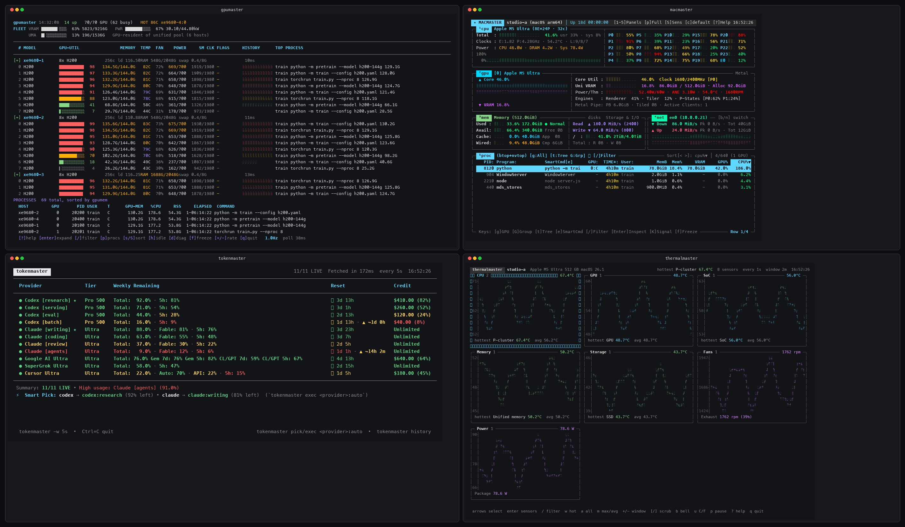
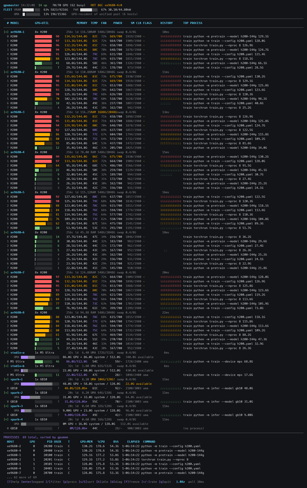
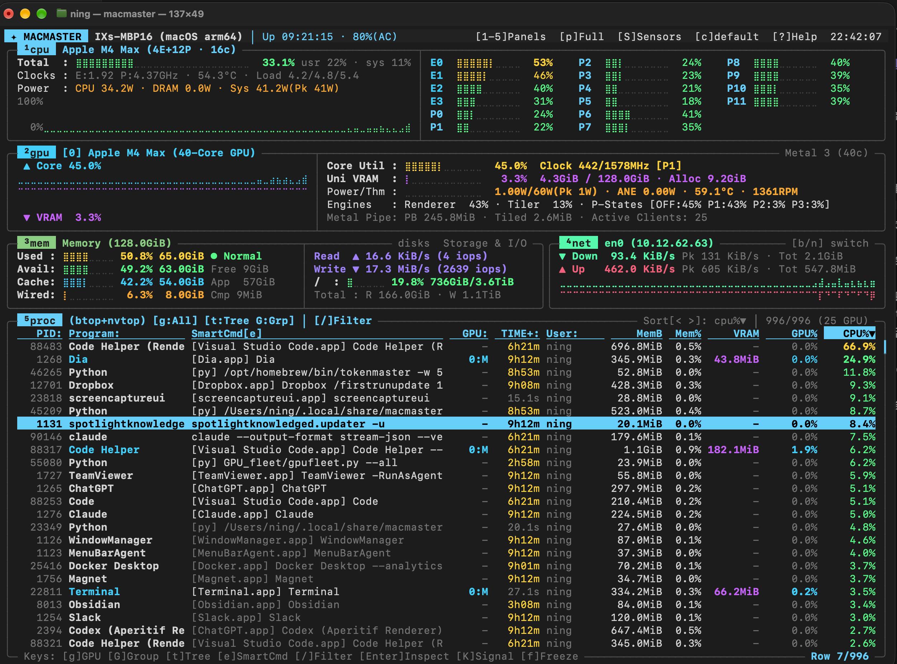
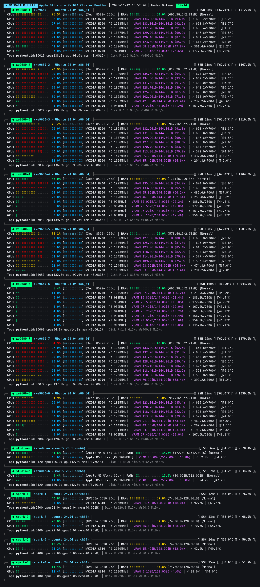
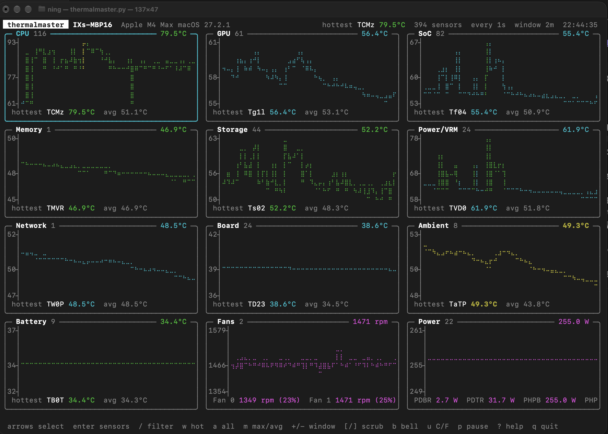
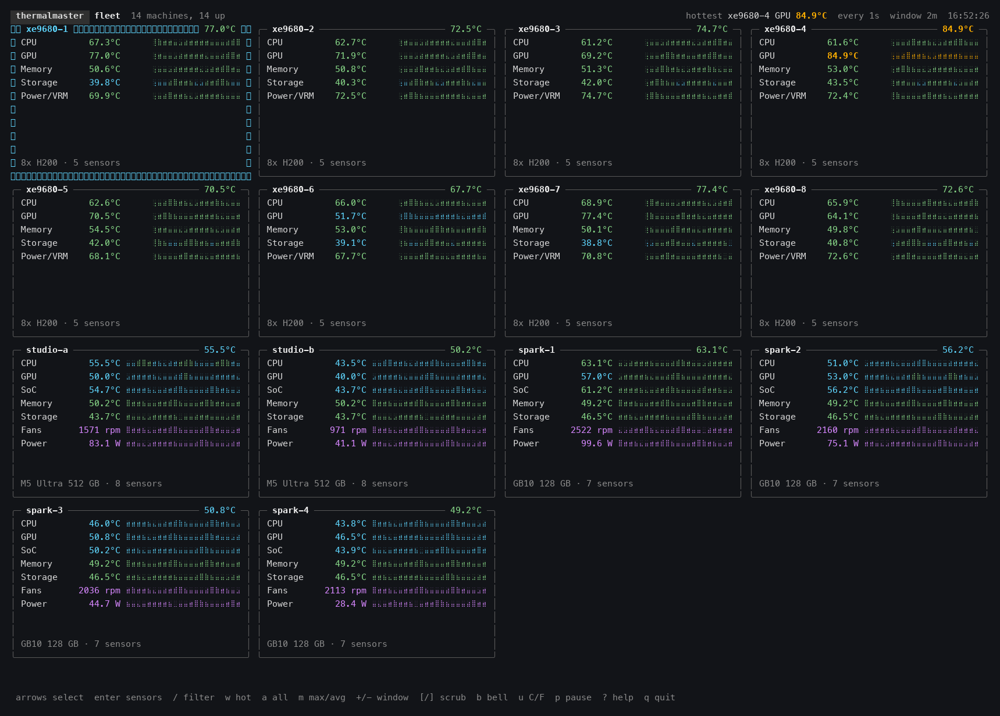

**English** | [中文](README.zh-Hant.md)

# master-cli

**Find a free GPU. Understand a slow machine. Keep your AI accounts working.**

Four terminal tools for the resources behind your AI work: GPU fleets, system telemetry, temperatures, and subscription quotas. Watch NVIDIA Linux nodes and Apple silicon Macs, investigate the process behind a bottleneck, and choose an AI account with quota to spare.

**macOS + Linux · Python 3.10+ · Zero third-party Python runtime packages · MIT**

[Install](#install) · [Fleet setup](#fleet-setup) · [AI accounts](#ai-accounts) · [Export and integrate](#export-and-integrate) · [Troubleshooting](#troubleshooting) · [Manuals](#manuals)

| Tool | Use it to… | Highlights |
|---|---|---|
| [`gpumaster`](docs/en/gpumaster.md) | Find capacity across your GPU fleet | Mixed NVIDIA / Apple silicon fleets, idle GPU selection, process ownership, JSON and Prometheus |
| [`macmaster`](docs/en/macmaster.md) | Explain what is happening on a machine | CPU + GPU + RAM + disks + network + processes, history graphs, recording and replay |
| [`thermalmaster`](docs/en/thermalmaster.md) | Catch heat, power and throttling problems | Sensor curves, hardware thresholds, fan speeds, thermal pressure, local and SSH fleet views |
| [`tokenmaster`](docs/en/tokenmaster.md) | See which AI account can take the next task | Six providers, multiple accounts, reset countdowns, usage pace, account selection and usage history |

The preview uses **illustrative data rendered by the toolkit's UI code**. Hardware names, subscription labels and readings are examples, rather than a tested compatibility list or performance measurements.



## Why master-cli

- **A fleet view that understands memory.** `gpumaster` separates discrete GPU VRAM from shared memory on Apple silicon and DGX Spark / GB10. Fleet totals avoid counting the same unified memory twice; derived or untrustworthy readings are marked.
- **An answer to “where can I run this?”** `gpumaster free --min-mem 20 -n 2` finds hosts with two qualifying idle GPUs. It also checks host RAM pressure, because an empty GPU on a memory-starved machine is a poor place to start a job. Selection is a snapshot; it does not reserve GPUs.
- **Context behind the numbers.** GPU processes sit alongside host load, RAM, swap and Linux PSI. Drill into system processes and thermal histories to investigate bottlenecks. Failed hosts retain an error state; GPU sampling failure does not discard readable host telemetry.
- **A small deployment footprint.** The source installer needs no pip packages or root. `gpumaster` and `thermalmaster --fleet` stream collectors over SSH without installing the toolkit on nodes. `macmaster --fleet` uses an installed copy on each remote host.
- **One workflow for AI subscriptions.** `tokenmaster` reads existing sign-ins, tracks named accounts, and can launch a provider CLI using a selected account. Provider requests run concurrently with a configurable refresh deadline and partial results.
- **Useful beyond the live screen.** All four tools expose JSON. Add system NDJSON recordings, thermal CSV logs, GPU Prometheus metrics, or a quota status line for your prompt or tmux.

## Install

### 1. Check prerequisites

The machine running the toolkit needs **Python 3.10+ with `curses`**, Bash, and a UTF-8 terminal. Cloning needs Git; remote monitoring needs an OpenSSH client.

```bash
python3 --version
python3 -c 'import curses; print("curses OK")'
```

| Capability | Additional requirements |
|---|---|
| NVIDIA GPU telemetry on Linux | A working NVIDIA driver; `gpumaster` uses `nvidia-smi`, while `macmaster` uses NVML with an `nvidia-smi` fallback |
| Apple silicon system / GPU telemetry | macOS native APIs and commands; no Python hardware packages |
| Local temperatures, fans and power | Sensors exposed through macOS IOKit / SMC or Linux sysfs; NVIDIA sensors use the driver's NVML library |
| `gpumaster` fleet | SSH key or agent login; remote Bash and stock utilities, plus `nvidia-smi` on NVIDIA Linux nodes |
| Thermal fleet | SSH login and remote `python3` on the non-interactive SSH `PATH` (the streamed sampler targets Python 3.8+) |
| `macmaster` fleet | Python 3.10+ and `macmaster` installed on each remote host |
| AI quotas | Supported provider credentials; network access for live provider queries |

Normal monitoring runs as your user. Fields depend on hardware, OS, drivers and permissions. GPU monitoring targets **NVIDIA on Linux and Apple silicon on macOS**; thermal monitoring also reads other sensors exposed by the OS.

### 2. Install from source

```bash
git clone https://github.com/stargazerscripter123/master-cli.git
cd master-cli
bash install.sh --check
bash install.sh
export PATH="$HOME/.local/bin:$PATH"
```

Add that `export PATH=…` line once to `~/.zshrc` or `~/.bashrc` for future interactive shells.

The installer writes six launchers into `~/.local/bin`: `master`, `gpumaster`, `macmaster`, `thermalmaster`, `tokenmaster`, and `btop-nvtop` (an alias of `macmaster`). It creates no system service and installs nothing on remote hosts.

**Keep this checkout in a stable location.** Launchers point at its `src/` directory and resolve `python3` from your `PATH` on every run. Use a working Python 3.10+; `gpumaster` rejects the macOS `/usr/bin/python3` shim. Source changes apply immediately. After moving the checkout, rerun the installer from its new location.

### 3. Verify and open a dashboard

```bash
master --version
master --help
macmaster --once               # first local system snapshot
thermalmaster --once           # first local sensor snapshot
```

Then run `macmaster` or `thermalmaster` in an interactive terminal for the live dashboard. Press `?` for help and `q` to quit. AI quotas and remote hosts need the setup below.

```bash
master gpu --help              # aliases: gpu, mac, thermal, token
master mac --json              # same as macmaster --json
```

<details>
<summary>Alternative: install a package in a Python virtual environment</summary>

From the cloned repository:

```bash
python3 -m venv .venv
. .venv/bin/activate
python -m pip install .
master --version
```

This installs a package copy into the environment. Activate it again in a new shell, or call `.venv/bin/master` directly. For development, use `python -m pip install -e .` so checkout edits apply immediately. Building may download `setuptools`; the toolkit declares no third-party runtime dependencies.

</details>

<details>
<summary>Custom install location, updates and removal</summary>

```bash
bash install.sh --prefix "$HOME/tools"
export PATH="$HOME/tools/bin:$PATH"

# Update the checkout used by source launchers:
git pull --ff-only

# Remove launchers from the default or custom prefix:
bash install.sh --uninstall
bash install.sh --prefix "$HOME/tools" --uninstall
```

Install writes those six command names in the selected `bin/`; uninstall removes those names. Choose a dedicated prefix if they would conflict with existing commands. Source and user configuration are preserved. Package installations can be updated with `python -m pip install --upgrade .` or removed with `python -m pip uninstall master-cli` in their environment.

</details>

## Fleet setup

### Establish SSH access

Put users, keys, ports and jump hosts in `~/.ssh/config`. Replace this example documentation address and user with your own:

```sshconfig
Host gpu-a
    HostName 192.0.2.10
    User your-user
    IdentityFile ~/.ssh/id_ed25519
```

Connect with `ssh gpu-a` once to verify the host fingerprint and login, then exit the remote shell. Confirm unattended access:

```bash
ssh -o BatchMode=yes gpu-a 'echo connected'
```

Collectors use batch SSH and cannot prompt for passwords or host-key confirmation. `gpumaster` enables strict host-key checking by default.

### GPU fleet: install on the viewer only

```bash
gpumaster init
# Edit ~/.config/gpumaster/hosts.json and replace the example hosts.
gpumaster check gpu-a
gpumaster --once
gpumaster
```

A minimal `hosts.json` is:

```json
{
  "refresh_seconds": 2.0,
  "hosts": [
    {"name": "training", "target": "gpu-a"}
  ]
}
```

`name` is the dashboard label; `target` is the SSH alias. `gpumaster init` refuses to overwrite an existing file. Use `gpumaster -c /path/to/hosts.json` for another inventory. The [full example](examples/gpumaster.hosts.json) adds host groups and hidden laptops; `--mode NAME` switches groups and `--all` includes hidden hosts.

The viewer sends `remote.sh` to remote `bash -s`: nodes need neither Python nor a toolkit installation. SSH connections are multiplexed, hosts are polled concurrently, and failures retry with backoff.

### Thermal fleet: stream the collector over SSH

```bash
cp examples/thermalmaster.fleet.json fleet.json
# Edit fleet.json to contain your own SSH aliases.
ssh -o BatchMode=yes gpu-a 'python3 --version'
thermalmaster --fleet fleet.json --once
thermalmaster --fleet fleet.json
```

Or use `thermalmaster --fleet gpu-a,mac-studio` after configuring both aliases. Check remote Python on every host: an interactive shell's Python setup may not apply to SSH commands. The viewer sends its collector to remote `python3 -`; no toolkit installation is needed there. Fleet-file entries marked `"mobile": true` are skipped unless you add `--mobile`. See the [example](examples/thermalmaster.fleet.json) and [thermal manual](docs/en/thermalmaster.md).

### System fleet: install on every monitored host

Run the source installation steps on each remote machine, then launch from the viewer:

```bash
macmaster --fleet local gpu-a mac-studio --once
macmaster --fleet local gpu-a mac-studio
```

This runs remote `macmaster --json`. The collector adds `~/.local/bin`, `/opt/homebrew/bin` and `/usr/local/bin` to the remote command's `PATH`; other locations must be visible in the non-interactive SSH environment. `macmaster --fleet` without host arguments watches only the local machine.

## AI accounts

Run `tokenmaster` on the machine holding your provider sign-ins. No fleet setup is required.

```bash
tokenmaster doctor                    # inspect credential availability
tokenmaster -p codex,claude            # start with providers you use
tokenmaster --watch --detail           # live quotas, reset times and model pools
```

| Provider | Credential / data source implemented by the tool |
|---|---|
| Codex | Existing Codex authentication and usage API; local session fallback |
| Claude | Claude credentials or macOS Keychain, usage API and local sessions |
| Antigravity | Local language-server RPC, or the [default Linux keyring quota API](docs/en/antigravity-linux.md) |
| Grok | Grok CLI credentials, a grok.com cookie, or an xAI API key |
| Cursor | Cursor Agent authentication, macOS Keychain or the IDE's state database |
| OpenRouter | `OPENROUTER_API_KEY` or credentials set through `tokenmaster auth` |

Integrations depend on provider responses and local credential formats. Missing limits, balances and model pools remain unavailable unless set manually; an API key alone does not imply access to subscription quotas. [Provider setup and manual quota overrides](docs/en/tokenmaster.md).

For multiple subscriptions, create named profiles and launch the appropriate native CLI:

```bash
tokenmaster account snapshot codex personal  # copy the current Codex sign-in
tokenmaster login claude work                # native CLI login into a named profile
tokenmaster account list
tokenmaster -p claude:default,claude:work
tokenmaster pick claude                      # recommend an account
tokenmaster exec claude:auto                 # launch Claude with the selected profile
```

`login` and `exec` need the provider's CLI installed. Selection considers quota, short-window headroom and reset timing; it chooses at launch rather than switching a running session. Profiles live under `~/.config/tokenmaster/profiles/` by default. Authentication commands can save or copy credentials there or into tokenmaster configuration, and providers may persist refreshed tokens. Keep that data private. [Account management](docs/en/tokenmaster.md#accounts).

## Export and integrate

```bash
# Find capacity; env/ssh formats select CUDA hosts.
gpumaster free --min-mem 20 -n 2
gpumaster free --min-mem 20 -n 2 --format json
gpumaster free --min-mem 20 -n 2 --format ssh

# Record system history and inspect a run.
macmaster --record run.jsonl --samples 60
macmaster --replay run.jsonl
macmaster --stream --samples 10       # NDJSON for another program

# Log thermals without opening a TUI.
thermalmaster --record temps.csv --headless --duration 10m

# Quotas in a prompt; usage history by model or project.
tokenmaster statusline --format tmux --no-refresh
tokenmaster history models --days 30
tokenmaster history projects --days 30 --export csv --output usage.csv
tokenmaster --watch --notify
```

For an HTTP dashboard and Prometheus endpoint, run on a machine that can reach your GPU hosts:

```bash
gpumaster serve --bind 127.0.0.1 --port 8765
```

Keep the process running; the installer does not create a service. In another terminal:

```bash
curl http://127.0.0.1:8765/api/fleet.json
curl http://127.0.0.1:8765/metrics
```

Open [the local dashboard](http://127.0.0.1:8765/) in a browser, or use `/fleet.txt` and `/fleet.ansi`. The server has no built-in authentication or TLS and exposes host and process information. For remote access, keep it on loopback and forward through SSH:

```bash
ssh -N -L 8765:127.0.0.1:8765 your-monitor-host
```

## More screenshots

The single-machine Mac screenshots show an Apple M4 Max system. Fleet and subscription views use illustrative data.

<details>
<summary>GPU fleet: per-GPU telemetry and processes</summary>



</details>

<details>
<summary>System monitor: Mac and fleet views</summary>




</details>

<details>
<summary>Thermal monitor: Mac and fleet views</summary>




</details>

<details>
<summary>AI quotas: providers and named accounts</summary>


</details>

## Troubleshooting

| Symptom | What to check |
|---|---|
| `command not found` | Add `~/.local/bin` (or your prefix's `bin/`) to `PATH`. A package install needs its virtual environment active. |
| Python version / `curses` error | Check `command -v python3`, `python3 --version`, and the `curses` import above. Source launchers use the first `python3` on `PATH`. |
| SSH host down / authentication fails | First make `ssh -o BatchMode=yes HOST 'echo connected'` work. Then use `gpumaster check HOST` or TUI diagnostics (`d`). |
| Remote `macmaster` not found | Install it remotely and make its launcher and Python visible to non-interactive SSH. |
| No thermal sensors / missing readings | Inspect `thermalmaster --probe` and `thermalmaster --all --once`. Containers, sandboxes and missing driver interfaces can hide sensors. |
| Apple GPU temperature / power missing in `gpumaster` | Extra fields use optional `macmon`; basic stock-command sampling leaves them unavailable. See the [GPU manual](docs/en/gpumaster.md#unified-memory). |
| AI provider unconfigured, partial or expired | Run `tokenmaster doctor`, select the provider with `-p`, and check its sign-in. For Antigravity, check a running language server or the [Linux keyring requirements](docs/en/antigravity-linux.md). |
| Misaligned terminal columns | Try `gpumaster --glyphs ascii`, `thermalmaster --glyphs ascii`, or `tokenmaster --width 110`. |

## Manuals

| Tool | English | 中文 |
|---|---|---|
| GPU fleet | [gpumaster](docs/en/gpumaster.md) | [gpumaster](docs/zh-Hant/gpumaster.md) |
| System monitor | [macmaster](docs/en/macmaster.md) | [macmaster](docs/zh-Hant/macmaster.md) |
| Thermal monitor | [thermalmaster](docs/en/thermalmaster.md) | [thermalmaster](docs/zh-Hant/thermalmaster.md) |
| AI quotas and accounts | [tokenmaster](docs/en/tokenmaster.md) | [tokenmaster](docs/zh-Hant/tokenmaster.md) |

Source is under `src/<tool>/`; inventories are in [`examples/`](examples/). `gpumaster` is the public name of the earlier GPU fleet tool. Local `hosts.json`, `fleet.json` and the `.tokenmaster/` fallback configuration directory are gitignored.

## Development and tests

From the repository root:

```bash
PYTHONPATH=src python3 -m unittest discover -s tests/gpumaster
PYTHONPATH=src python3 -m unittest discover -s tests/thermalmaster
PYTHONPATH=src python3 -m unittest discover -s tests/tokenmaster
PYTHONPATH=src python3 -m unittest discover -s tests -p 'test_dispatcher.py'
```

Fixtures and mocked providers mean no remote fleet or provider login is needed. One thermal test also reads the live macOS thermal-pressure interface; a sandbox can block that check. These suites do not establish hardware coverage or live provider compatibility.

Preview captured GPU data without connecting to a node:

```bash
gpumaster -c examples/gpumaster.hosts.json --replay tests/gpumaster/fixtures --once
```

## License

[MIT](LICENSE).
