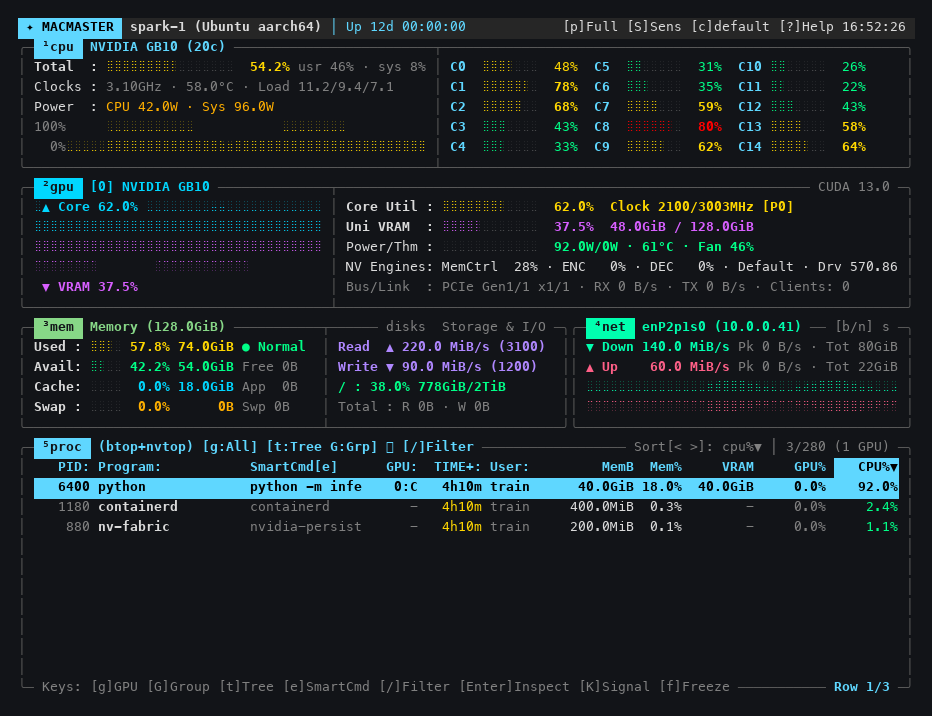
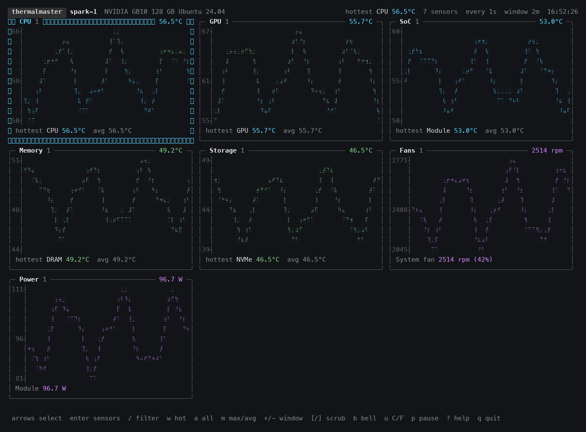
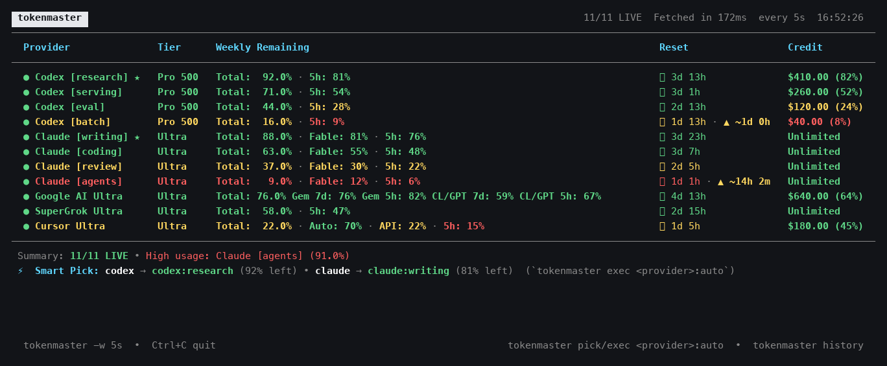

# master-cli

Four terminal tools, one toolkit. They share an installer and a `master` command, and each one still runs on its own. The runtime is the Python standard library: no third-party packages, no agent on the machines you monitor.

| Command | What it shows |
|---|---|
| [`gpumaster`](docs/en/gpumaster.md) | Every GPU across every machine, over SSH |
| [`macmaster`](docs/en/macmaster.md) | This machine: CPU, GPU, memory, disks, network, processes |
| [`thermalmaster`](docs/en/thermalmaster.md) | Temperatures, fans and power, locally or over SSH |
| [`tokenmaster`](docs/en/tokenmaster.md) | Weekly quota and credits for six AI subscriptions |

中文說明在 [`README.zh-Hant.md`](README.zh-Hant.md)，各工具的中文手冊在 [`docs/zh-Hant/`](docs/zh-Hant/).

`gpumaster` is the public name of the tool previously called GPU fleet.

## Demo

These are the tools' own terminal screens. The machines and subscriptions below are a sample fleet, drawn by the same layout code the commands use.

**All four** — the same sample fleet, side by side


**gpumaster** — 8× Dell PowerEdge XE9680 (8× NVIDIA H200), 2× Mac Studio (M5 Ultra, 512 GB), 4× DGX Spark (128 GB)


**macmaster** on one machine. A Mac Studio with an M5 Ultra and 512 GB of unified memory:


A DGX Spark with 128 GB of unified memory:



**macmaster --fleet** — the same 14 machines:


**thermalmaster** on one machine. The Mac Studio:


The DGX Spark:



**thermalmaster --fleet** — the same 14 machines:


**tokenmaster** — 4× Codex Pro 500, 4× Claude Ultra, Google AI Ultra, SuperGrok Ultra, Cursor Ultra



## Requirements

- Python 3.10 or newer, with `curses` (part of the standard library on macOS and Linux)
- An OpenSSH client on the machine where you watch a fleet
- On a GPU node: `ssh`, `bash`, and either `nvidia-smi` or, on Apple silicon, the stock `ioreg` / `sysctl` / `vm_stat`
- `thermalmaster --fleet` also needs `python3` on each remote machine

Nothing in this toolkit is installed on the remote machines. `gpumaster` pipes `remote.sh` into `bash`. `thermalmaster --fleet` pipes its own program into `python3`.

## Install

From this directory:

```bash
bash install.sh
```

That writes launchers into `~/.local/bin`. They point back at this checkout, so edits here take effect immediately. `bash install.sh --prefix "$HOME/.local"` is the same default. `bash install.sh --check` prints the plan. `bash install.sh --uninstall` removes the launchers.

Or install the package into the current environment:

```bash
python3 -m pip install -e .
```

Either way the commands are `master`, `gpumaster`, `macmaster`, `thermalmaster`, `tokenmaster`, and `btop-nvtop` (an alias of `macmaster`).

```bash
master                 # list the tools
master gpumaster       # same as gpumaster
master gpu --once      # short aliases: gpu, mac, thermal, token
```

## First run

```bash
gpumaster init                         # writes ~/.config/gpumaster/hosts.json
# edit that file, using SSH aliases from ~/.ssh/config
gpumaster

macmaster                              # this machine
thermalmaster                          # this machine's sensors

cp examples/thermalmaster.fleet.json fleet.json
# edit fleet.json, then:
thermalmaster --fleet fleet.json

tokenmaster                            # reads credentials already on this machine
```

Example fleet files live in [`examples/`](examples/). They are illustrations. Copy one and put your own SSH aliases in it. `hosts.json` and `fleet.json` are gitignored so a later commit does not pick up your inventory. SSH keys, tokens and API keys stay in `~/.ssh`, the system keychain, or the provider's own config directory. They are not part of this repository.

## Layout

```
src/mastercli/        master dispatcher
src/gpumaster/        GPU fleet (remote.sh is the script sent to each node)
src/macmaster/        local system and GPU monitor
src/thermalmaster/    sensors; app.py is the file streamed over SSH
src/tokenmaster/      subscription quotas
docs/en/              English manuals
docs/zh-Hant/         Traditional Chinese manuals
docs/assets/          terminal screenshots used above
examples/             sample hosts.json and fleet.json
tests/                offline tests, including captured hardware fixtures
```

## Tests

No network. From the repository root:

```bash
PYTHONPATH=src python3 -m unittest discover -s tests/gpumaster
PYTHONPATH=src python3 -m unittest discover -s tests/thermalmaster
PYTHONPATH=src python3 -m unittest discover -s tests/tokenmaster
PYTHONPATH=src python3 -m unittest discover -s tests -p 'test_dispatcher.py'
```

## License

[MIT](LICENSE).
