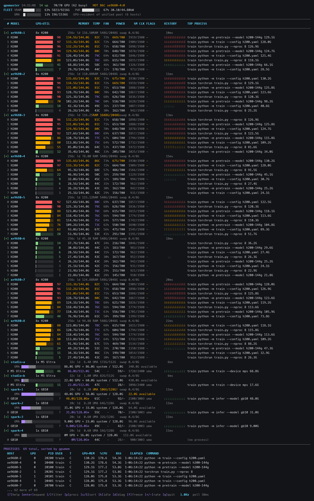
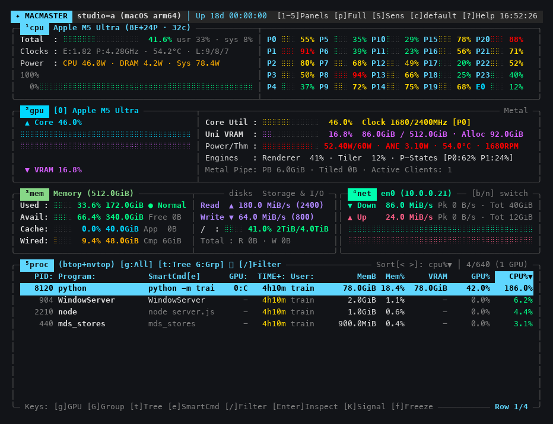
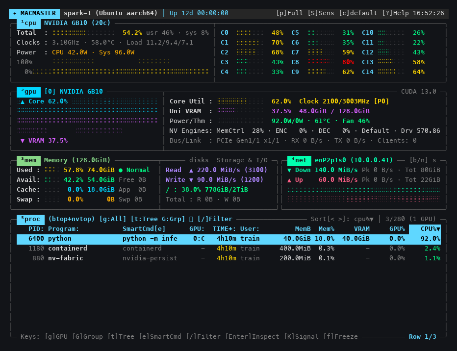
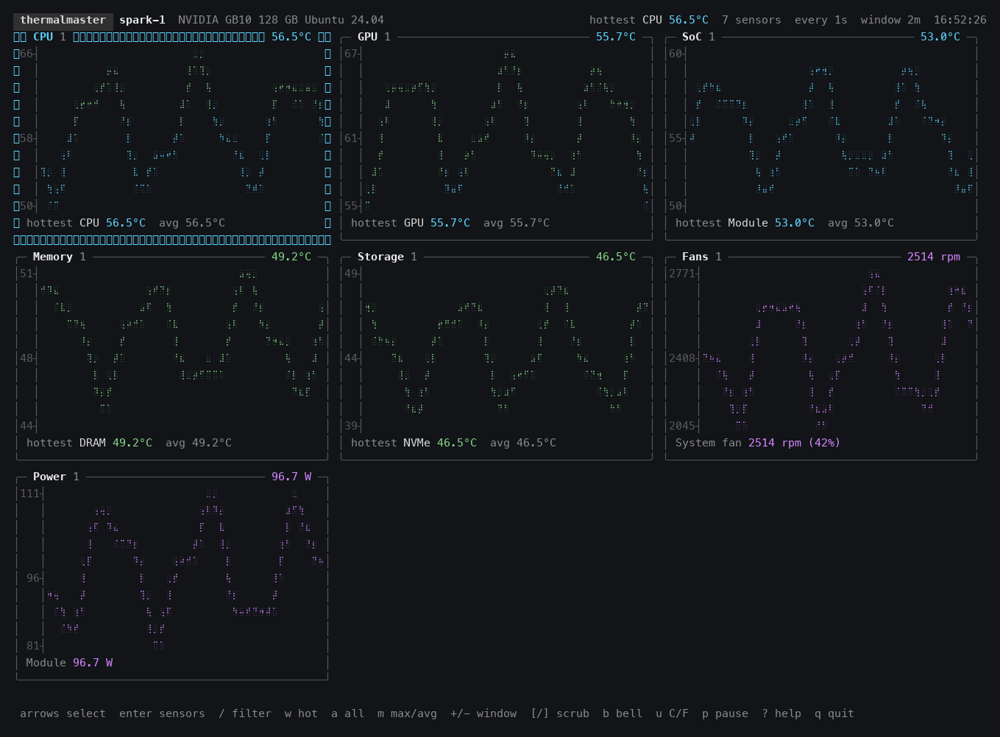
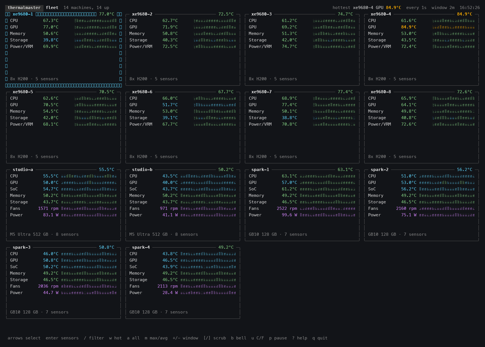
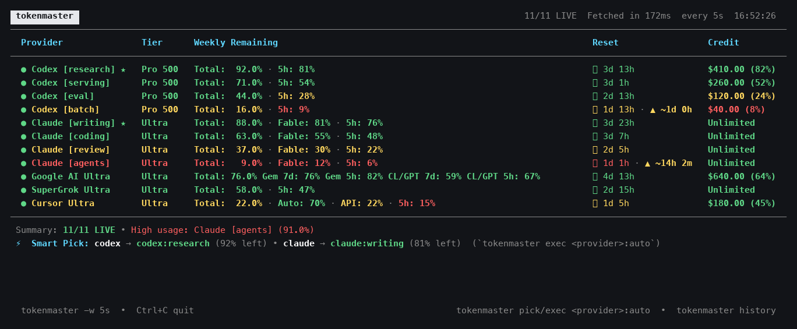

# master-cli

四個終端機工具，放在同一套工具集裡。它們共用一個安裝程式和 `master` 命令，也可以各自單獨執行。執行時只用 Python 標準函式庫：沒有第三方套件，也不用在被監控的機器上裝代理程式。

| 命令 | 它顯示什麼 |
|---|---|
| [`gpumaster`](docs/zh-Hant/gpumaster.md) | 透過 SSH 看每一台機器上的每一張 GPU |
| [`macmaster`](docs/zh-Hant/macmaster.md) | 本機的 CPU、GPU、記憶體、磁碟、網路與行程 |
| [`thermalmaster`](docs/zh-Hant/thermalmaster.md) | 溫度、風扇與功耗，本機或透過 SSH |
| [`tokenmaster`](docs/zh-Hant/tokenmaster.md) | 六個 AI 訂閱的每週配額與點數 |

English manuals: [`README.md`](README.md) and [`docs/en/`](docs/en/).

`gpumaster` 是這套公開工具裡的名稱。它就是原本的 GPU fleet 工具。

## 示範

下面是工具自己畫出來的終端機畫面。機器和訂閱都是一套示範用的機群，用的是命令實際採用的同一套版面。

**四個一起看** — 同一套示範機群，四個終端機並排


**gpumaster** — 8 台 Dell PowerEdge XE9680（每台 8 張 NVIDIA H200）、2 台 Mac Studio（M5 Ultra、512 GB）、4 台 DGX Spark（128 GB）



**macmaster** 單機。一台 512 GB 統一記憶體的 M5 Ultra Mac Studio：



一台 128 GB 統一記憶體的 DGX Spark：



**macmaster --fleet** — 同一組 14 台機器：


**thermalmaster** 單機。Mac Studio：


DGX Spark：



**thermalmaster --fleet** — 同一組 14 台機器：



**tokenmaster** — 4 個 Codex Pro 500、4 個 Claude Ultra、1 個 Google AI Ultra、1 個 SuperGrok Ultra、1 個 Cursor Ultra



## 需求

- Python 3.10 或更新版本，並且帶有 `curses`（macOS 與 Linux 的標準函式庫已包含）
- 你用來查看機群的那台電腦上要有 OpenSSH 客戶端
- GPU 節點上只需要 `ssh`、`bash`，以及 `nvidia-smi`；Apple 晶片的 Mac 則用系統自帶的 `ioreg`、`sysctl`、`vm_stat`
- `thermalmaster --fleet` 還需要遠端有 `python3`

遠端機器不用安裝這個工具集。`gpumaster` 把 `remote.sh` 送進遠端的 `bash`。`thermalmaster --fleet` 把自己的程式送進遠端的 `python3`。

## 安裝

在這個目錄執行：

```bash
bash install.sh
```

它會把啟動腳本寫到 `~/.local/bin`。腳本指回這份原始碼，所以之後改這裡會立刻生效。`bash install.sh --prefix "$HOME/.local"` 與預設相同。`bash install.sh --check` 只顯示計畫。`bash install.sh --uninstall` 移除啟動腳本。

也可以裝進目前的 Python 環境：

```bash
python3 -m pip install -e .
```

兩種方式都會提供 `master`、`gpumaster`、`macmaster`、`thermalmaster`、`tokenmaster`，以及 `macmaster` 的別名 `btop-nvtop`。

```bash
master                 # 列出工具
master gpumaster       # 等同 gpumaster
master gpu --once      # 短別名：gpu、mac、thermal、token
```

## 第一次使用

```bash
gpumaster init                         # 寫出 ~/.config/gpumaster/hosts.json
# 用 ~/.ssh/config 裡的別名編輯這個檔案
gpumaster

macmaster                              # 本機
thermalmaster                          # 本機感測器

cp examples/thermalmaster.fleet.json fleet.json
# 編輯 fleet.json 之後：
thermalmaster --fleet fleet.json

tokenmaster                            # 讀取這台電腦上已經存在的憑證
```

[`examples/`](examples/) 裡的機群檔只是範例。複製一份，填上你自己的 SSH 別名。`hosts.json` 和 `fleet.json` 已被 git 忽略，之後的提交不會把你的主機清單帶進去。SSH 金鑰、權杖和 API 金鑰留在 `~/.ssh`、系統鑰匙圈，或各服務自己的設定目錄。它們不屬於這個儲存庫。

## 目錄

```
src/mastercli/        master 分派程式
src/gpumaster/        GPU 機群（remote.sh 是送到每台節點的腳本）
src/macmaster/        本機系統與 GPU 監控
src/thermalmaster/    感測器；app.py 是透過 SSH 串流出去的那個檔案
src/tokenmaster/      訂閱配額
docs/en/              英文手冊
docs/zh-Hant/         繁體中文手冊
docs/assets/          上面用到的終端機截圖
examples/             hosts.json 與 fleet.json 範例
tests/                離線測試，含硬體擷取樣本
```

## 測試

不需要網路。在儲存庫根目錄：

```bash
PYTHONPATH=src python3 -m unittest discover -s tests/gpumaster
PYTHONPATH=src python3 -m unittest discover -s tests/thermalmaster
PYTHONPATH=src python3 -m unittest discover -s tests/tokenmaster
PYTHONPATH=src python3 -m unittest discover -s tests -p 'test_dispatcher.py'
```

## 授權

[MIT](LICENSE)。
