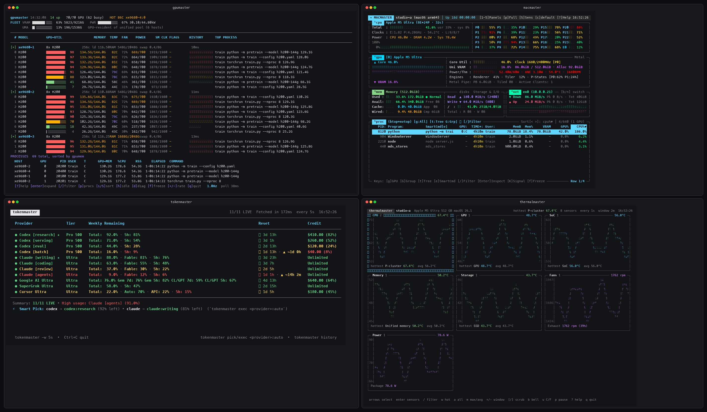
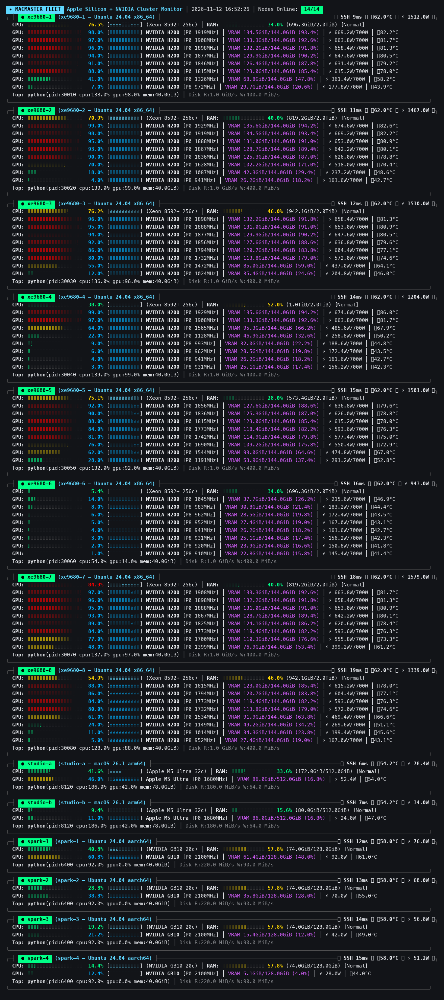
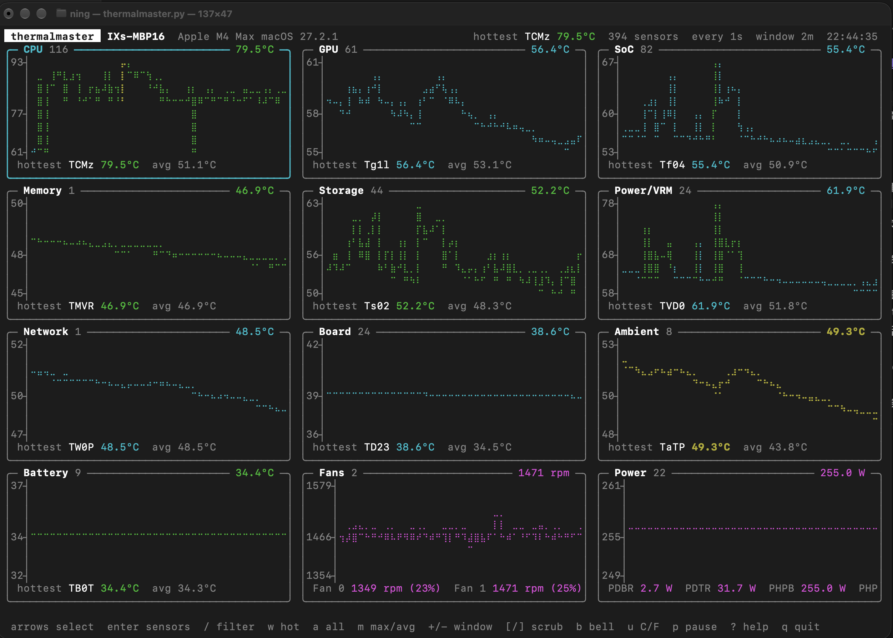

[English](README.md) | **中文**

# master-cli

**找出可用 GPU、看懂機器瓶頸，讓 AI 帳號的剩餘配額派上用場。**

四個終端機工具，一起掌握 AI 工作背後的資源：GPU 機群、系統狀態、溫度與訂閱配額。在同一套工作流程中查看 NVIDIA Linux 節點與 Apple 晶片 Mac、追查造成瓶頸的行程，並選擇仍有配額的 AI 帳號。

**macOS + Linux · Python 3.10+ · 無第三方 Python 執行期套件 · MIT**

[安裝](#安裝) · [機群部署](#機群部署) · [AI 帳號](#ai-帳號) · [匯出與整合](#匯出與整合) · [疑難排解](#疑難排解) · [完整手冊](#完整手冊)

| 工具 | 適合解決的問題 | 主要能力 |
|---|---|---|
| [`gpumaster`](docs/zh-Hant/gpumaster.md) | 哪台機器還有 GPU 可以跑工作？ | NVIDIA 與 Apple 晶片混合機群、閒置 GPU 篩選、行程歸屬、JSON 與 Prometheus |
| [`macmaster`](docs/zh-Hant/macmaster.md) | 這台機器究竟卡在哪裡？ | CPU、GPU、RAM、磁碟、網路、行程同屏顯示，支援歷史曲線、錄製與回放 |
| [`thermalmaster`](docs/zh-Hant/thermalmaster.md) | 是溫度、功耗還是降頻在拖慢工作？ | 感測器曲線、硬體門檻、風扇、熱壓力，本機與 SSH 機群檢視 |
| [`tokenmaster`](docs/zh-Hant/tokenmaster.md) | 下一個任務該用哪個 AI 帳號？ | 六個平台、多帳號、重設倒數、消耗節奏、帳號選擇與用量歷史 |

下圖為**使用工具本身 UI 程式碼繪製的示意資料**。硬體名稱、訂閱方案與讀數都是範例，不代表已驗證的相容清單或效能量測。



## 為什麼使用 master-cli

- **理解不同硬體的記憶體。** `gpumaster` 區分獨立 GPU 的 VRAM，以及 Apple 晶片、DGX Spark / GB10 的共享記憶體。機群總計避免把同一份統一記憶體重複相加；推導值與不可信讀數都有標示。
- **直接回答「這個工作可以放哪裡跑？」** `gpumaster free --min-mem 20 -n 2` 找出有兩張符合條件之閒置 GPU 的主機，同時檢查 RAM 壓力，避免只看空顯卡卻忽略主機記憶體不足。結果是當下快照，不會預約或鎖定 GPU。
- **指標旁邊就有診斷線索。** GPU 行程可對照主機負載、RAM、swap 與 Linux PSI；系統行程與溫度歷史可進一步追查瓶頸。離線主機保留錯誤狀態，GPU 採樣失敗時也不丟掉仍可讀取的主機資料。
- **部署負擔小。** 原始碼安裝程式不需要 pip 套件或 root。`gpumaster` 與 `thermalmaster --fleet` 透過 SSH 傳送蒐集程式，節點不必安裝工具集；`macmaster --fleet` 則使用遠端已安裝的版本。
- **把多個 AI 訂閱變成一套工作流程。** `tokenmaster` 讀取既有登入資料、管理具名帳號，並可用選定帳號啟動平台原生 CLI。平台請求並行執行，支援可設定的重新整理期限及部分結果。
- **看完畫面還能繼續用資料。** 四個工具都有 JSON 輸出，另有系統 NDJSON 錄製、溫度 CSV、GPU Prometheus 指標，以及 shell 提示字元或 tmux 可用的配額狀態列。

## 安裝

### 1. 檢查執行環境

執行工具的電腦需要 **Python 3.10+ 與 `curses`**、Bash，以及 UTF-8 終端機。複製儲存庫需要 Git；遠端監控需要 OpenSSH 客戶端。

```bash
python3 --version
python3 -c 'import curses; print("curses OK")'
```

| 能力 | 額外需求 |
|---|---|
| Linux NVIDIA GPU 指標 | 可正常運作的 NVIDIA 驅動程式；`gpumaster` 使用 `nvidia-smi`，`macmaster` 使用 NVML 並提供 `nvidia-smi` 後援路徑 |
| Apple 晶片系統與 GPU 指標 | macOS 原生 API 與命令，不需要 Python 硬體套件 |
| 本機溫度、風扇與功耗 | macOS IOKit / SMC 或 Linux sysfs 暴露的感測器；NVIDIA 感測器使用驅動程式的 NVML 函式庫 |
| `gpumaster` 機群 | SSH 金鑰或 agent 登入；遠端有 Bash 與系統基本命令，NVIDIA Linux 節點另需 `nvidia-smi` |
| 溫度機群 | SSH 登入，且非互動式 SSH 的 `PATH` 可找到遠端 `python3`；串流採樣程式以 Python 3.8+ 為目標 |
| `macmaster` 機群 | 每台遠端都有 Python 3.10+，並已安裝 `macmaster` |
| AI 配額 | 支援平台的憑證；查詢即時資料需要網路 |

一般監控以目前使用者身分執行。欄位取決於硬體、OS、驅動程式與權限。GPU 監控主要針對 **Linux NVIDIA 與 macOS Apple 晶片**；溫度工具也能讀取 OS 暴露的其他感測器。

### 2. 從原始碼安裝

```bash
git clone https://github.com/stargazerscripter123/master-cli.git
cd master-cli
bash install.sh --check
bash install.sh
export PATH="$HOME/.local/bin:$PATH"
```

把上述 `export PATH=…` 那一行加入 `~/.zshrc` 或 `~/.bashrc` 一次，之後開啟新的互動式 shell 也能使用命令。

安裝程式會在 `~/.local/bin` 寫入六個啟動腳本：`master`、`gpumaster`、`macmaster`、`thermalmaster`、`tokenmaster`，以及 `macmaster` 的別名 `btop-nvtop`。它不會建立系統服務，也不會安裝任何東西到遠端主機。

**請把這份 checkout 放在固定位置。** 啟動腳本指向它的 `src/`，每次執行都從 `PATH` 尋找 `python3`。請使用可正常執行的 Python 3.10+；`gpumaster` 會拒絕 macOS 的 `/usr/bin/python3` shim。原始碼變更立即生效；移動目錄後，要從新位置重新執行安裝程式。

### 3. 驗證安裝並開啟畫面

```bash
master --version
master --help
macmaster --once               # 第一份本機系統快照
thermalmaster --once           # 第一份本機感測器快照
```

接著在互動式終端機執行 `macmaster` 或 `thermalmaster`，即可開啟即時儀表板。按 `?` 查看說明，按 `q` 離開。遠端主機與 AI 配額請繼續依下方步驟設定。

```bash
master gpu --help              # 短別名：gpu、mac、thermal、token
master mac --json              # 等同 macmaster --json
```

<details>
<summary>替代方式：在 Python 虛擬環境中安裝套件</summary>

在已複製的儲存庫內執行：

```bash
python3 -m venv .venv
. .venv/bin/activate
python -m pip install .
master --version
```

這會把套件副本裝進虛擬環境。新的 shell 需要重新啟用環境，或直接執行 `.venv/bin/master`。開發時可改用 `python -m pip install -e .`，讓 checkout 編輯立即生效。建置可能會下載 `setuptools`；工具集未宣告第三方執行期依賴。

</details>

<details>
<summary>自訂安裝位置、更新與移除</summary>

```bash
bash install.sh --prefix "$HOME/tools"
export PATH="$HOME/tools/bin:$PATH"

# 更新原始碼啟動腳本使用的 checkout：
git pull --ff-only

# 移除預設位置或自訂 prefix 中的啟動腳本：
bash install.sh --uninstall
bash install.sh --prefix "$HOME/tools" --uninstall
```

安裝會寫入所選 `bin/` 下的六個命令名稱，解除安裝則移除這些名稱。如果會與既有命令衝突，請使用獨立 prefix。原始碼與使用者設定會保留。套件安裝則在相應環境中以 `python -m pip install --upgrade .` 更新，或以 `python -m pip uninstall master-cli` 移除。

</details>

## 機群部署

### 先確認 SSH 可以連線

把使用者、金鑰、port 與跳板主機放在 `~/.ssh/config`。將以下文件示範位址與使用者換成自己的設定：

```sshconfig
Host gpu-a
    HostName 192.0.2.10
    User your-user
    IdentityFile ~/.ssh/id_ed25519
```

先執行一次 `ssh gpu-a`，核對主機指紋並確認能登入，然後離開遠端 shell。接著確認非互動式登入：

```bash
ssh -o BatchMode=yes gpu-a 'echo connected'
```

蒐集程式使用 batch SSH，不能停下來詢問密碼或主機金鑰。`gpumaster` 預設啟用嚴格主機金鑰檢查。

### GPU 機群：只需在查看端安裝

```bash
gpumaster init
# 編輯 ~/.config/gpumaster/hosts.json，替換其中的範例主機。
gpumaster check gpu-a
gpumaster --once
gpumaster
```

最小 `hosts.json` 如下：

```json
{
  "refresh_seconds": 2.0,
  "hosts": [
    {"name": "training", "target": "gpu-a"}
  ]
}
```

`name` 是儀表板名稱，`target` 是 SSH 別名。`gpumaster init` 會拒絕覆寫既有檔案。其他清單可用 `gpumaster -c /path/to/hosts.json` 指定。[完整範例](examples/gpumaster.hosts.json) 示範具名群組與隱藏筆電；以 `--mode NAME` 切換群組，`--all` 納入隱藏主機。

查看端把 `remote.sh` 傳進遠端 `bash -s`，節點不需要 Python 或本工具集。SSH 連線會多工重用，主機並行採樣，失敗則退避重試。

### 溫度機群：透過 SSH 傳送採樣程式

```bash
cp examples/thermalmaster.fleet.json fleet.json
# 編輯 fleet.json，換成自己的 SSH 別名。
ssh -o BatchMode=yes gpu-a 'python3 --version'
thermalmaster --fleet fleet.json --once
thermalmaster --fleet fleet.json
```

兩個別名都設定好後，也可使用 `thermalmaster --fleet gpu-a,mac-studio`。每台主機都要檢查遠端 Python：互動式 shell 的 Python 設定不一定適用於 SSH 命令。查看端把採樣程式傳進遠端 `python3 -`，遠端無須安裝工具集。機群檔中 `"mobile": true` 的主機預設略過，加上 `--mobile` 才納入。詳見[範例](examples/thermalmaster.fleet.json)與[溫度手冊](docs/zh-Hant/thermalmaster.md)。

### 系統機群：每台被監控主機都要安裝

先在每台遠端機器完成原始碼安裝，再從查看端執行：

```bash
macmaster --fleet local gpu-a mac-studio --once
macmaster --fleet local gpu-a mac-studio
```

此模式在遠端執行 `macmaster --json`。蒐集器會把 `~/.local/bin`、`/opt/homebrew/bin` 與 `/usr/local/bin` 加入遠端命令的 `PATH`；其他位置必須能在非互動式 SSH 環境中找到。單獨執行 `macmaster --fleet` 而不指定主機時，只監控本機。

## AI 帳號

在存有平台登入資料的機器上執行 `tokenmaster`，不需要機群設定。

```bash
tokenmaster doctor                    # 檢查憑證是否可用
tokenmaster -p codex,claude            # 先選擇自己使用的平台
tokenmaster --watch --detail           # 即時配額、重設時間與模型池
```

| 平台 | 工具已實作的憑證與資料來源 |
|---|---|
| Codex | 既有 Codex 驗證、用量 API 與本地工作階段後援資料 |
| Claude | Claude 憑證或 macOS 鑰匙圈、用量 API 與本地工作階段 |
| Antigravity | 本地語言伺服器 RPC，或 [Linux 預設鑰匙圈配額 API](docs/zh-Hant/antigravity-linux.md) |
| Grok | Grok CLI 憑證、grok.com cookie 或 xAI API 金鑰 |
| Cursor | Cursor Agent 驗證、macOS 鑰匙圈或 IDE 狀態資料庫 |
| OpenRouter | `OPENROUTER_API_KEY`，或透過 `tokenmaster auth` 設定的憑證 |

整合結果取決於平台回應與本地憑證格式。缺少的上限、點數與模型池會保持不可用，除非手動設定；單有 API 金鑰不代表能取得訂閱配額。[平台設定與手動配額覆寫](docs/zh-Hant/tokenmaster.md)。

多個訂閱可使用具名 profile，再以指定帳號啟動平台原生 CLI：

```bash
tokenmaster account snapshot codex personal  # 複製目前的 Codex 登入
tokenmaster login claude work                # 以原生 CLI 登入具名 profile
tokenmaster account list
tokenmaster -p claude:default,claude:work
tokenmaster pick claude                      # 推薦帳號
tokenmaster exec claude:auto                 # 以選定 profile 啟動 Claude
```

`login` 與 `exec` 需要先安裝平台 CLI。選擇會考慮配額、短視窗餘裕及重設時間，在啟動時決定帳號，不會替執行中的工作階段自動換帳號。Profile 預設位於 `~/.config/tokenmaster/profiles/`；驗證命令可以將憑證儲存或複製到此處或 tokenmaster 設定，平台也可能寫回重新整理後的權杖。請妥善保存這些私人資料。[帳號管理](docs/zh-Hant/tokenmaster.md#帳號)。

## 匯出與整合

```bash
# 找出可用資源；env / ssh 格式會選擇 CUDA 主機。
gpumaster free --min-mem 20 -n 2
gpumaster free --min-mem 20 -n 2 --format json
gpumaster free --min-mem 20 -n 2 --format ssh

# 錄下系統歷史，再查看執行過程。
macmaster --record run.jsonl --samples 60
macmaster --replay run.jsonl
macmaster --stream --samples 10       # 給其他程式使用的 NDJSON

# 不開啟 TUI，持續記錄溫度。
thermalmaster --record temps.csv --headless --duration 10m

# 提示字元配額；按模型或專案查歷史。
tokenmaster statusline --format tmux --no-refresh
tokenmaster history models --days 30
tokenmaster history projects --days 30 --export csv --output usage.csv
tokenmaster --watch --notify
```

需要 HTTP 儀表板與 Prometheus 端點時，在可以連到 GPU 主機的電腦上執行：

```bash
gpumaster serve --bind 127.0.0.1 --port 8765
```

保留該程式執行；安裝程式不會建立服務。另開一個終端機查詢：

```bash
curl http://127.0.0.1:8765/api/fleet.json
curl http://127.0.0.1:8765/metrics
```

也可以用瀏覽器開啟[本機儀表板](http://127.0.0.1:8765/)，或使用 `/fleet.txt` 與 `/fleet.ansi`。伺服器沒有內建驗證與 TLS，且會提供主機及行程資訊。遠端存取可維持 loopback 綁定，再使用 SSH 轉送：

```bash
ssh -N -L 8765:127.0.0.1:8765 your-monitor-host
```

## 更多畫面

下方 Mac 單機截圖顯示 Apple M4 Max 系統；機群與訂閱畫面使用示意資料。

<details>
<summary>GPU 機群：逐 GPU 指標與行程</summary>


</details>

<details>
<summary>系統監控：Mac 單機與機群</summary>




</details>

<details>
<summary>溫度監控：Mac 單機與機群</summary>




</details>

<details>
<summary>AI 配額：多平台與具名帳號</summary>


</details>

## 疑難排解

| 症狀 | 檢查方式 |
|---|---|
| 出現 `command not found` | 將 `~/.local/bin` 或自訂 prefix 的 `bin/` 加入 `PATH`。套件安裝需啟用相應虛擬環境。 |
| Python 版本或 `curses` 錯誤 | 檢查 `command -v python3`、`python3 --version` 與前述 `curses` 匯入。原始碼啟動腳本使用 `PATH` 中第一個 `python3`。 |
| SSH 主機離線或驗證失敗 | 先讓 `ssh -o BatchMode=yes HOST 'echo connected'` 成功，再用 `gpumaster check HOST` 或 TUI 的 `d` 診斷。 |
| 找不到遠端 `macmaster` | 在遠端安裝，並確認非互動式 SSH 可以找到啟動腳本與 Python。 |
| 找不到溫度感測器或讀數缺失 | 查看 `thermalmaster --probe` 與 `thermalmaster --all --once`。容器、沙箱或缺少驅動介面可能使感測器不可見。 |
| `gpumaster` 缺少 Apple GPU 溫度或功耗 | 額外欄位使用選配 `macmon`，基本內建命令採樣不會提供。詳見 [GPU 手冊](docs/zh-Hant/gpumaster.md#統一記憶體)。 |
| AI 平台未設定、資料不完整或憑證過期 | 執行 `tokenmaster doctor`、用 `-p` 選定平台並檢查登入。Antigravity 可使用語言伺服器，或依 [Linux 鑰匙圈需求](docs/zh-Hant/antigravity-linux.md)設定後援。 |
| 終端機欄位錯位 | 嘗試 `gpumaster --glyphs ascii`、`thermalmaster --glyphs ascii` 或 `tokenmaster --width 110`。 |

## 完整手冊

| 工具 | English | 中文 |
|---|---|---|
| GPU 機群 | [gpumaster](docs/en/gpumaster.md) | [gpumaster](docs/zh-Hant/gpumaster.md) |
| 系統監控 | [macmaster](docs/en/macmaster.md) | [macmaster](docs/zh-Hant/macmaster.md) |
| 溫度監控 | [thermalmaster](docs/en/thermalmaster.md) | [thermalmaster](docs/zh-Hant/thermalmaster.md) |
| AI 配額與帳號 | [tokenmaster](docs/en/tokenmaster.md) | [tokenmaster](docs/zh-Hant/tokenmaster.md) |

原始碼位於 `src/<tool>/`，主機清單在 [`examples/`](examples/)。`gpumaster` 是原 GPU fleet 工具的公開名稱。本地 `hosts.json`、`fleet.json` 與設定後援目錄 `.tokenmaster/` 都已加入 gitignore。

## 開發與測試

在儲存庫根目錄執行：

```bash
PYTHONPATH=src python3 -m unittest discover -s tests/gpumaster
PYTHONPATH=src python3 -m unittest discover -s tests/thermalmaster
PYTHONPATH=src python3 -m unittest discover -s tests/tokenmaster
PYTHONPATH=src python3 -m unittest discover -s tests -p 'test_dispatcher.py'
```

測試使用 fixture 與模擬平台，不需要遠端機群或平台登入。有一條溫度測試還會讀取 macOS 即時熱壓力介面，沙箱可能阻擋該檢查。這些測試不等於完整硬體覆蓋或即時平台相容性驗證。

無須連線，即可預覽已擷取的 GPU 資料：

```bash
gpumaster -c examples/gpumaster.hosts.json --replay tests/gpumaster/fixtures --once
```

## 授權

[MIT](LICENSE)。
